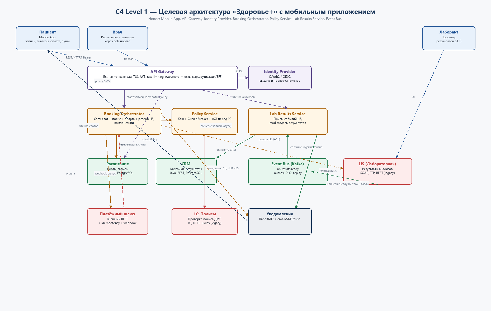

# Задание 2. Целевая интеграционная архитектура (C4 Level 1)

**Цель:** спроектировать целевую интеграционную архитектуру ИТ-ландшафта «Здоровье+» для успешного внедрения мобильного приложения.

Диаграмма: [`target-context.puml`](target-context.puml) (исходник C4-PlantUML) и [`target-context.png`](target-context.png) (рендер).

## Что изменилось относительно текущего ландшафта

Текущий ландшафт — это «звезда» вокруг веб-портала с прямыми синхронными вызовами к каждой системе, включая нестабильные 1С и LIS. В целевой архитектуре появляются четыре новых элемента, которые снимают системные проблемы из Task1:

- **Mobile App** — новый актор/клиент (пациент).
- **API Gateway** — единая точка входа (решает INT-010): TLS-терминация, проверка токена, rate limiting, идемпотентность по `Idempotency-Key`, маршрутизация и агрегация (BFF). Через него ходят и мобильное приложение, и веб-портал.
- **Identity Provider (OAuth2/OIDC)** — централизованная аутентификация и выдача токенов (закрывает подмену сессии SD-007).
- **Booking Orchestrator (Saga)** — оркестратор распределённой операции «запись + полис + оплата + резерв анализов» с компенсациями (Task3.2).
- **Event Bus (Kafka)** и **Lab Results Service** — событийная доставка результатов анализов из LIS с гарантией и чтением из read-модели (Task3.1).
- **Policy Service (кэш + ACL перед 1С)** — anti-corruption layer и кэш, снижающий нагрузку на 1С (Task4.1).

Существующие системы (Расписание, CRM, LIS, 1С, Платёжный шлюз, Уведомления, Веб-портал) сохраняются.

## Паттерны интеграции: выбор и обоснование

Для каждой новой интеграции указан паттерн, архитектурный стиль взаимодействия и причина выбора. Стиль выбирался по критериям из урока (нужен ли немедленный ответ пользователю, допустима ли задержка, нужна ли развязка по времени, требования согласованности — CAP).

| Интеграция | Паттерн | Стиль взаимодействия | Почему так |
| --- | --- | --- | --- |
| Mobile App → API Gateway | **API Gateway / BFF** | Синхронный request-response, REST over HTTPS | Пациенту нужен немедленный ответ (UI). Нужна единая дверь для безопасности, rate limiting и идемпотентности. Gateway агрегирует вызовы и прячет разнородность бэкенда от мобильного клиента. |
| API Gateway → Identity Provider | **Token-based auth (OAuth2/OIDC)** | Синхронный, проверка/интроспекция JWT | Аутентификация обязана быть синхронной до доступа к данным. Централизация токенов убирает самодельные сессии и подмену (SD-007). |
| API Gateway → Booking Orchestrator | **Orchestration** | Синхронный запуск, внутри — смешанный | Старт операции инициирует пользователь и ждёт результат; дальше оркестратор управляет шагами и компенсациями централизованно (детали — Task3.2). |
| Orchestrator → 1С (Полисы) через **Policy Service** | **Anti-Corruption Layer + Cache + Circuit Breaker** | Синхронный request-response с деградацией | Проверка полиса нужна в момент записи (синхронно), но 1С нестабилен (INT-003). ACL транслирует меняющийся XML/SOAP-контракт в стабильный JSON, кэш и CB защищают от перегрузки и каскадных зависаний. |
| Orchestrator → Платёжный шлюз | **Synchronous call + Idempotency + Transactional Outbox + Callback/Webhook** | Синхронный вызов, асинхронное доподтверждение статуса | Оплату пациент ждёт синхронно, но статус нельзя терять при тайм-ауте (INT-001). Идемпотентный ключ не даёт двойного списания, outbox и webhook гарантируют фиксацию итогового статуса. |
| Orchestrator → Расписание | **Request-response + idempotent reserve** | Синхронный REST | Резерв слота нужен немедленно и влияет на ответ пользователю. Идемпотентный `reserve` по `sagaId` убирает дубли (INT-005). |
| Orchestrator → LIS (резерв забора биоматериала) | **Request-response через адаптер** | Синхронный REST через ACL | Резерв времени в лаборатории — часть пользовательского сценария, нужен ответ сразу; адаптер скрывает SOAP/legacy LIS. |
| LIS → Lab Results Service | **Event-driven + Transactional Outbox + CDC/Adapter** | Асинхронный pub/sub через Kafka | Готовность анализа — событие, пациент не ждёт его в реальном времени. Событийная модель с outbox и DLQ даёт гарантированную доставку и развязку по времени (детали — Task3.1). |
| Lab Results Service → CRM / Read-модель | **CQRS (read model) + idempotent consumer** | Асинхронный, запись в read-store | Разделяем приём события и чтение. Идемпотентный консьюмер по `resultId` убирает дубли (INT-008), read-модель даёт быстрый отклик приложению. |
| Сервисы → Уведомления | **Publish-subscribe** | Асинхронный, AMQP (RabbitMQ) | Отправка пушей/SMS не должна блокировать бизнес-операцию. Паблишер не ждёт доставки, издатель и провайдеры развязаны. |

## Комбинация стилей в сценарии записи

В главном сценарии стили комбинируются осознанно: **синхронно** то, что влияет на немедленный ответ пациенту и требует сильной согласованности в моменте (резерв слота, проверка полиса, оплата, резерв лаборатории), и **асинхронно (события)** то, что терпит задержку и выигрывает от развязки (уведомления, доставка результатов анализов). Такое разделение следует из CAP/дерева решений: для денег и слотов выбираем согласованность и подтверждённый ответ, для доставки результатов — доступность и гарантию «доставлено хотя бы один раз» с дедупликацией.
