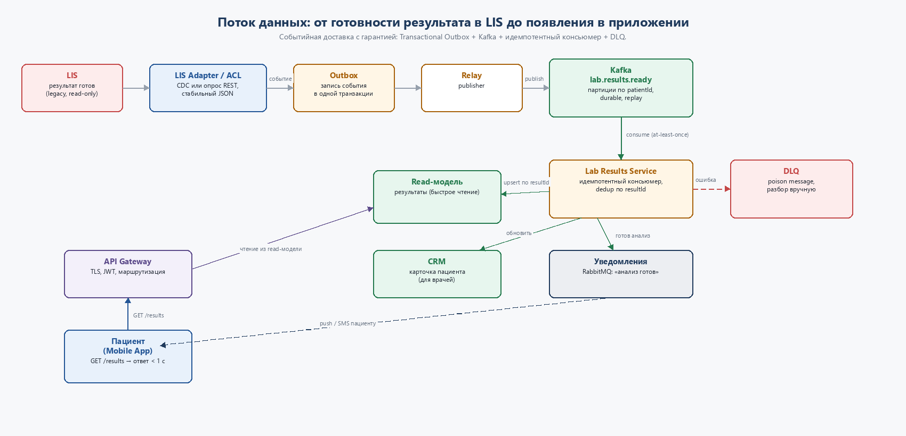

# Задание 3.1. Надёжная поставка результатов анализов в мобильное приложение

**Цель:** спроектировать архитектуру доставки результатов анализов в мобильное приложение с гарантированным процессом и минимальной задержкой.

## Проблема (из материалов)

Сейчас LIS передаёт данные в CRM через FTP/REST ненадёжно: FTP падает с 425, нет авто-переотправки, задержка до 2 часов, дубли XML-файлов, сообщения застревают в очереди (INT-002, INT-008, INT-011, SD-005, интервью Елены и Анны). Лаборанты не влияют на автоматическую загрузку — LIS только на чтение. Итог: пациент не видит анализы онлайн, врач получает неактуальные или задвоенные данные.

## Выбранное решение (текстовое описание)

Переходим от файлового «толкания» (FTP-батч) к **событийной доставке через брокер с гарантией «ровно один эффект»**:

1. **LIS Adapter (Change Data Capture / опрос).** Так как LIS — legacy и только на чтение, рядом ставится адаптер (anti-corruption layer). Он фиксирует готовность результата — через CDC по БД LIS или опрос LIS REST API — и формирует доменное событие `LabResultReady` в стабильном JSON-контракте, пряча SOAP/FTP.
2. **Transactional Outbox.** Событие сначала пишется в таблицу outbox в одной транзакции с чтением/фиксацией факта «обработано». Отдельный publisher-релей читает outbox и публикует в Kafka. Это исключает потерю события при сбое сети (решает «файлы теряются»).
3. **Event Bus (Kafka), топик `lab.results.ready`.** Партиционирование по `patientId`, durable-лог с репликацией и возможностью replay. Держит пиковую нагрузку и переживает всплески (в отличие от падающего FTP и переполняемой очереди).
4. **Lab Results Service — идемпотентный консьюмер.** Дедупликация по уникальному `resultId` (решает дубли INT-008). Пишет в собственную read-модель (CQRS), оптимизированную под чтение приложением. При неустранимой ошибке сообщение уходит в **Dead-Letter Queue** для ручного разбора, не блокируя поток.
5. **Обновление CRM и уведомление.** Lab Results Service асинхронно обновляет CRM (для врачей) и публикует событие в «Уведомления» → пуш пациенту «анализ готов».
6. **Чтение из приложения.** Мобильное приложение читает результаты синхронно через API Gateway → Lab Results Service (быстрый read-store), а не ждёт прохождения по цепочке.

Гарантия доставки: at-least-once на стороне брокера + идемпотентный консьюмер = эффект применяется ровно один раз. Минимальная задержка: событие вместо батча раз в N часов — результат виден через секунды после готовности. Простота эксплуатации: единый контракт события, DLQ и трассировка вместо ручного перезапуска FTP-скрипта (INT-007, SD-005).

## Таблица сравнения вариантов

Оценка по ключевым критериям задания: гарантированная доставка, минимальная задержка, поддержка пиковой нагрузки, простота эксплуатации, связанность систем (чем меньше — тем лучше). Шкала: «−» плохо, «±» средне, «+» хорошо.

| Критерий | A. FTP-батч (as-is) | B. Прямой REST push LIS→CRM с ретраями | C. События через брокер + Outbox + DLQ (выбрано) |
| --- | --- | --- | --- |
| Гарантированная доставка | − теряются файлы, нет переотправки | ± ретраи есть, но при недоступности CRM данные теряются | + outbox + durable-лог + DLQ, потеря исключена |
| Задержка | − батч, до 2 часов | + секунды, но хрупко | + секунды |
| Пиковая нагрузка | − FTP не рассчитан | − синхронный вызов перегружает CRM | + брокер буферизует всплески |
| Дедупликация | − дубли XML | ± нужно реализовывать вручную | + идемпотентность по `resultId` |
| Простота эксплуатации | − ручной перезапуск | ± тесная связка, падение CRM роняет приём | + DLQ, replay, трассировка |
| Связанность | ± файловая, но хрупкая | − жёсткая синхронная связка LIS↔CRM | + развязка по времени через события |
| **Итог** | **Отклонено** | **Отклонено** | **Выбрано** |

## Выбор инструментов

| Задача | Выбор | Альтернатива | Обоснование |
| --- | --- | --- | --- |
| Брокер событий | **Apache Kafka** | RabbitMQ | Нужен durable-лог с replay, высокой пропускной способностью и партиционированием под пиковую нагрузку и будущие 50 000 пользователей. RabbitMQ уже используется для уведомлений и показал переполнение (INT-004, SD-006) — для гарантированного потока анализов берём лог-ориентированный брокер. |
| Надёжная публикация | **Transactional Outbox + relay** | Прямая публикация из адаптера | Исключает потерю события при падении между «обработал» и «опубликовал» — прямой корень проблемы «файлы теряются». |
| Защита от дублей | **Идемпотентный консьюмер (dedup по `resultId`)** | Exactly-once семантика брокера | Дедупликация по бизнес-ключу проще и надёжнее сквозного exactly-once; закрывает INT-008. |
| Съём готовности из LIS | **CDC / опрос через адаптер (ACL)** | Доработка LIS | LIS legacy и read-only, менять его нельзя; адаптер изолирует SOAP/FTP и даёт стабильный контракт. |
| Чтение приложением | **Read-модель (CQRS) + кэш** | Чтение напрямую из CRM | Быстрый отклик (<1 с) и разгрузка CRM. |

## Блок-схема потока данных

Исходник: [`data-flow.puml`](data-flow.puml), рендер: [`data-flow.png`](data-flow.png).

Путь события: **LIS (результат готов)** → **LIS Adapter (CDC/опрос)** → **Outbox** → **Relay** → **Kafka `lab.results.ready`** → **Lab Results Service (идемпотентный консьюмер, dedup по `resultId`)** → **Read-модель** + обновление **CRM** + событие в **Уведомления** → **пуш пациенту**. Пациент читает результат из read-модели через **API Gateway**. Сообщения-ошибки уходят в **DLQ**.
