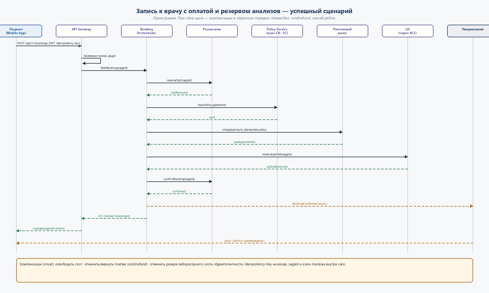

# Задание 3.2. Автоматизация бизнес-операции «Запись к врачу с оплатой и резервом анализов»

**Цель:** спроектировать отказоустойчивый сценарий, включающий бронирование слота записи и лабораторного исследования, проверку полиса и оплату.

## Проблема (из материалов)

Главная функция приложения — запись на приём — работает нестабильно: дубли записей (INT-005, SD-003), потеря подтверждений (SD-002), двойные списания (INT-001, SD-009). После оплаты часто нужен резерв времени для забора биоматериалов в LIS. У текущей синхронной цепочки нет механизмов отката при сбоях (постановка задания).

## Успешный сценарий (Sequence Diagram)

Исходник: [`sequence-success.puml`](sequence-success.puml), рендер: [`sequence-success.png`](sequence-success.png).

Порядок шагов: Mobile App → API Gateway (проверка токена, `Idempotency-Key`) → Booking Orchestrator. Оркестратор последовательно: **1)** резервирует слот в «Расписании», **2)** проверяет полис через Policy Service (кэш + CB перед 1С), **3)** проводит оплату через платёжный шлюз (идемпотентный ключ), **4)** резервирует время забора биоматериала в LIS, **5)** подтверждает запись и **6)** публикует событие в «Уведомления» (асинхронно). Пациенту возвращается подтверждение.

## Обоснование выбора типа SAGA

Выбран тип **оркестрация (orchestration-based saga)**, а не хореография. Сценарий состоит из 4–5 разнородных шагов с жёстким порядком и сложной логикой отката (деньги, слоты, legacy-системы), поэтому нужен единый управляющий компонент, который знает текущее состояние саги и запускает компенсации в правильном порядке. Централизованная оркестрация проще в отладке и наблюдении — это критично, учитывая, что в текущем ландшафте нет распределённой трассировки (INT-007); хореография на событиях размазала бы логику отката по системам и усложнила диагностику. Оркестратор также естественно хранит состояние саги и ключи идемпотентности для корректных повторов.

## Компенсирующие транзакции

Для трёх ключевых шагов с побочными эффектами (запись) определены компенсации. Проверка полиса — операция только на чтение, компенсации не требует.

| Шаг сценария | Компенсирующее действие | Какой риск устраняется |
| --- | --- | --- |
| Резерв слота в «Расписании» | Освободить слот (release по `sagaId`) | Занятый, но неоплаченный слот блокирует других пациентов; дубли/«мёртвые» брони (INT-005, SD-003) |
| Оплата через платёжный шлюз | Отмена авторизации / возврат (void или refund по `paymentId`) | Списание денег без предоставленной услуги, двойное списание (INT-001, SD-009) |
| Резерв забора биоматериала в LIS | Отменить резерв лабораторного слота | «Осиротевший» резерв в лаборатории при сбое на последующем шаге; занятые впустую мощности LIS |

Компенсации выполняются в обратном порядке от точки сбоя. Пример: если оплата прошла, а резерв LIS упал — оркестратор возвращает платёж и освобождает слот, приводя систему в согласованное состояние.

## Механизм идемпотентности на входе

1. **Ключ идемпотентности от клиента.** Мобильное приложение генерирует `Idempotency-Key` (UUID) на каждую бизнес-попытку записи и повторяет его при ретраях (двойное нажатие, обрыв мобильной сети).
2. **Дедупликация на API Gateway.** Gateway хранит ключ в быстром store (например, Redis) с TTL вместе с хешем тела запроса и сохранённым ответом. Повторный запрос с тем же ключом не запускает новую сагу, а возвращает ранее сохранённый результат. Это закрывает дубли записей на входе (INT-005, SD-003).
3. **Идемпотентность внутри саги.** Оркестратор ведёт состояние саги по `sagaId`; каждый шаг вызывает нижестоящие системы идемпотентно: резерв слота по `sagaId`, оплата — с идемпотентным ключом платёжного шлюза (один и тот же ключ при повторе не списывает дважды), консьюмеры дедуплицируют по бизнес-ключу.
4. **Согласованность с БД.** Записи резервов хранятся с уникальным ограничением по (`sagaId`, тип шага), так что повторная вставка не создаёт дубль.
