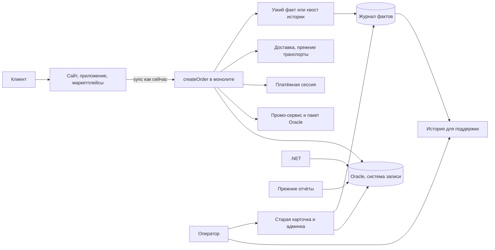

# Трансформация RetailCore

Документ заполнен по шаблону урока «Поиск точек трансформации и проектирование целевой архитектуры». Он описывает ближайший этап, а не программу замены платформы.

Точка трансформации здесь — участок, который одновременно мешает бизнес-цели, меняется в известных ограничениях и проверяется метрикой. Боль, которую нельзя сдвинуть сейчас, остаётся техдолгом или ограничением. Доработка без метрики в этот список не попадает.

Связанные документы: [requirements.md](../Task1/requirements.md), [architecture-canvas.md](../Task2/architecture-canvas.md), [as-is-analysis.md](../Task2/as-is-analysis.md), [migration-roadmap.md](../Task4/migration-roadmap.md), [cutover-plan.md](../Task4/cutover-plan.md). Диаграмма первого этапа: [to-be.drawio](to-be.drawio).

Числовых базовых и целевых значений в источниках нет. В таблицах метрик названо, что измеряем. Порог и период, где их нет, назначает указанный владелец до старта. Подставленных p95 и процентов в документе нет.

## 1. Бизнес-цель

Ближайший этап нужен, чтобы поддержка объясняла клиенту состояние заказа по отклонениям, не собирая его из трёх команд, и чтобы оформление заказа от этого не стало хуже.

### Контекст цели

| Параметр | Описание |
| --- | --- |
| Текущая проблема | Обещание клиенту расходится с фактом. `CONFIRMED` в коде означает «платёжная сессия создана». Формальный цикл техлида другой. Карточка заказа не отвечает, где заказ, что дальше и почему ушли от обычного сценария |
| Кого затрагивает | Клиент, оператор поддержки, смежные команды, которых дёргают на разбор. Бизнес теряет доверие к статусу и к цифрам, но сами цифры этот этап не выравнивает |
| Желаемое изменение | По покрытым сценариям Ольги внутренний пользователь видит шаг, сырой статус и источник. Старая карточка работает. Ответ оформления клиенту не меняется |
| Горизонт изменений | Первый этап: фазы 0 и 1 дорожной карты, картина ближайших трёх месяцев |
| Ожидаемый эффект | Меньше эскалаций «что с заказом» там, где журнал уже покрывает сценарий. Насколько меньше — не обещано числом |

Если этот этап не сделать, цель Дмитрия «одна картина по заказам и меньше ручной работы между командами» не с чего начать: и фасад партнёра, и сверка показателя кормятся журналом фактов. Ускорение коммерческих изменений и запуск персонализации этим этапом не достигаются и не обещаются.

## 2. Уточнённые требования

| Исходная формулировка | Что показали интервью и AS-IS | Уточнённое требование первого этапа | Обоснование |
| --- | --- | --- | --- |
| Через год запустить сервисы персонализации и отойти от Oracle | Дмитрий измеряет год устойчивостью заказа, скоростью типовых изменений, одной картиной данных и снижением ручной работы. Андрей: правила лежат в пакетах Oracle | Первый этап не запускает новые продукты и не меняет СУБД | Иначе ближайший шаг — перепись ядра. Это не проходит проверку «можно изменить сейчас» |
| Статусы заказа должны быть понятны | Три языка: формальный цикл, коды `createOrder`, экран клиента. Карточка не источник правды | Система хранит сырой статус и источник правки. Клиентский статус показывается только там, где справочник уже согласован. Оператор отвечает на три вопроса Ольги по покрытым сценариям | Без справочника «понятный статус» будет ещё одним списком. Справочник — работа фазы 0, не выдуманный перечень |
| Платформа должна быстрее принимать коммерческие изменения | Ветки канала и промо сидят в горячем методе. Вынос оформления Андрей и Дмитрий считают зоной высшего риска | В этом этапе расчёт цены, промо, маршрут и оплата не переносятся. Если вставка в транзакцию разрешена, записывается только факт, какой путь промо уже сработал | Ускорение правил — цель года. Ближайший измеримый эффект — видимость, не новый калькулятор |
| Интеграции доставки и отчёты нужно упорядочить | Четыре транспорта, staging на каждый заказ, отчёты читают операционную Oracle | В первый этап эти контуры не входят. Они остаются следующими точками, когда журнал уже проверяется | Иначе первый релиз зависит от невыбранного партнёра и неназванного показателя |

Уточнённое требование первого этапа в одной фразе. По заказу из согласованного набора исключений оператор видит шаг и источник, не обходя соседние системы. Граница — сценарии, которые журнал покрывает. Исключение, которого в журнале нет, показано как дыра, а не как «статуса не было». Клиентский экран в этот этап не переключается.

## 3. Ограничения

| Ограничение | Тип | Как влияет на решение | Можно ли изменить в ближайшем этапе |
| --- | --- | --- | --- |
| Нельзя заметно ухудшить оформление, оплату и обещание доставки. Порога нет, G-3 | Организационное, срок | Нельзя разрезать `createOrder` и нельзя добавлять синхронный вызов наружу | Нет. Сигнал ухудшения Дмитрий называет до любых включений на горячем пути. Для чтения истории сигнал не блокирует старт |
| Нельзя остановить коммерческую разработку | Организационное | Этап не занимает монолит переписыванием | Нет |
| On-premise, физические серверы почти без запаса | Инфраструктура | Читаемая модель — одно отдельное хранилище, не новый кластер и не брокер | Нет |
| Oracle хранит строку заказа, пакет `legacy_promo_pkg` и `INT_ORDER_EXPORT` | Технологическое, данные | Oracle остаётся системой записи заказа. Журнал её не подменяет | Нет |
| Срок отказа от Oracle не назван, G-11 | Срок, внешнее | Замена СУБД не проектируется. Если дата окажется внутри года, останавливается вся карта, не только этот этап | Неизвестно. Ворота фазы 0 |
| Граница транзакции `createOrder` не видна, G-4 | Технологическое | Лишняя вставка факта допустима только с согласия Андрея. Иначе журнал читает уже существующую историю статусов | Частично: ответ можно получить, саму границу в этом этапе не перекраиваем |
| Контракты партнёров и полный справочник статусов не приложены | Данные, организационное | Нельзя обещать клиенту новый статус и нельзя выбирать партнёра по имени | Нет, пока фаза 0 не закроет G-6, G-7, G-8 |

Решения, которые выглядят правильно и невозможны в этих рамках: микросервисы по блокам учебной схемы, общий контракт всех служб доставки, вынос оплаты, замена Oracle копированием данных, брокер «чтобы события были событиями».

## 4. Препятствия текущего состояния

| Препятствие | Где проявляется | Влияние на бизнес-цель | Причина | Источник |
| --- | --- | --- | --- | --- |
| Нет одной модели состояния заказа | Статусы в коде, batch, админке и в рассказе техлида не совпадают | Поддержка не объясняет заказ, клиент видит противоречие | Переходы не собраны в одном месте, `CONFIRMED` означает сессию оплаты | Код, Андрей, Ольга |
| Карточка заказа не источник правды | Повторная оплата, частичная отмена, зависшая доставка, маркетплейс | Один вопрос клиента стоит нескольких команд | История собирается людьми | Ольга |
| Ручная правка статуса оставляет неполный след | Админка | Заказ доживает до утра, но объяснение теряется | Регламент покрывает не всю практику | Андрей, Ольга, G-13 |
| Два пути промо неэквивалентны | `createOrder` и `legacy_promo_pkg` | Спор о сумме скидки | Запасной путь урезан и не записан | Код, Андрей |
| Четыре транспорта доставки и дубли заявок | Партнёры, .NET, очередь повтора | Срок меняется после оформления, дубли разбирают руками | Нет одного контракта, staging пишется на каждый заказ | Ирина, код |
| Отчёты читают операционную Oracle | Python, BI | Пик оформления делит ресурс с выборками, три функции видят три выручки | Нет потока фактов | Максим, Дмитрий |
| Горячий путь нельзя отрезать по схеме | Один метод: цена, промо, staging, маршрут, резерв, оплата | Любой разрез бьёт по зоне, которую спонсор запретил трогать первой | Скрытые зависимости и логика в Oracle | Андрей, код |
| Наличие как синхронная зависимость checkout | Названо устно | Если правда, это риск оформления | Вызова нет ни в коде, ни на схеме | Только Андрей, G-5 |

Формула по главному препятствию. Разные модули пишут разные статусы одного заказа, оператор не видит шаг, цель «понятное обещание клиенту» не выполняется даже там, где заказ технически жив.

## 5. Точки трансформации первого этапа

В ближайший этап входят две точки. Обе проверяются без изменения ответа клиенту.

| Точка трансформации | Какое препятствие закрывает | Что меняем | Почему это можно сделать сейчас | Ожидаемый эффект | Метрика проверки |
| --- | --- | --- | --- | --- | --- |
| TP-1. История состояния заказа | Три языка статуса и карточка, которая не отвечает на три вопроса | Журнал фактов перехода и читаемая история для поддержки. Система записи строки заказа остаётся Oracle | Чтение не стоит на ответе клиенту. Андрей сам назвал чтение статусов первым кандидатом. Старая карточка не выключается, откат — перестать смотреть в новую историю | Оператор закрывает покрытый сценарий без обхода трёх команд | Доля обращений набора Ольги, закрытых без эскалации. Доля заказов набора, по которым история отвечает на три вопроса или явно показывает дыру |
| TP-2. Факт пути промо | Два алгоритма скидки, расхождение сумм необъяснимо | В тот же журнал пишется имя уже выбранного пути: промо-сервис или пакет Oracle. Расчёт не переносится | Только если Андрей разрешил узкую вставку. Отдельного релиза нет, это тот же флаг, что и вставка TP-1 | Спор о сумме начинается с имени алгоритма | Доля заказов с запасным путём, у которых имя пути записано. Контроль: число оформлений и `PAYMENT_PENDING` не сдвигается необъяснённо |

Проверка. TP-1 связана с целью объяснимости, делается чтением и обратима, метрика названа. TP-2 связана с целью одной картины по деньгам скидки, но реализуема только вместе со вставкой. Если вставку запретят, TP-2 выпадает из этапа: хвост старой истории путь промо не содержит. Это записано в паспорте, а не отложено молча.

### Паспорт TP-1. История состояния заказа

| Поле | Что записано |
| --- | --- |
| Название | История состояния заказа |
| Проблема AS-IS | Нет модели состояний, которую поддержка может прочитать. Код, формальный цикл и экран клиента расходятся |
| Бизнес-влияние | Повторные обращения и эскалации. Клиент воспринимает молчание как потерянный заказ |
| Ограничение | Не менять ответ оформления. Не выключать админку. Не объявлять историю системой записи |
| Изменение | Журнал фактов: идентификатор заказа, сырой статус, причина если она уже есть, канал, корреляция, время, источник. История собирается в отдельном хранилище и заново собирается из журнала |
| Что не делаем | Не вводим клиентский статус там, где справочник G-6 пуст. Не забираем у людей право ручной правки. Не покрываем сценарии, которых нет в фактах |
| Метрика | Доля обращений набора без эскалации. Доля заказов набора с ответом на три вопроса или с явной дырой |
| Риски | Вставка удлиняет транзакцию. Часть ручных правок в журнал не попадёт, пока G-13 неполон |
| Следующий шаг | Фаза 0: G-4, G-6, G-13 и ответ, можно ли узкую вставку. До ответа журнал не включается на горячий путь |

Запасной путь TP-1, если вставку запретят: читать уже существующую историю статусов, без новой записи в `createOrder`. Метрика та же, полнота хуже, риск для оформления ниже. Это не провал точки, это её граница.

### Паспорт TP-2. Факт пути промо

| Поле | Что записано |
| --- | --- |
| Название | Факт пути промо |
| Проблема AS-IS | Скидка считается промо-сервисом или пакетом Oracle. Результаты не совпадают, выбор нигде не записан |
| Бизнес-влияние | Поддержка и финансы спорят о сумме. Это часть цели «одна картина», не цель переписать акции |
| Ограничение | Оба алгоритма остаются. Checkout не падает из-за промо, этот компромисс сохраняется |
| Изменение | Одна узкая запись в журнале TP-1 в момент уже сделанного выбора |
| Что не делаем | Не выносим расчёт. Не выравниваем правила двух путей. Не делаем TP-2, если вставки нет |
| Метрика | Доля заказов запасного пути с записанным именем пути |
| Риски | Тот же, что у вставки TP-1 |
| Следующий шаг | Имена двух путей подтверждает Андрей, G-9. Без имён факт писать нечем |

### Матрица прослеживаемости

| Препятствие | Бизнес-эффект | Точка | Архитектурное решение | Метрика |
| --- | --- | --- | --- | --- |
| Три языка статуса | Оператор отвечает, где заказ и почему отклонение | TP-1 | Журнал фактов и модель чтения, Oracle остаётся системой записи | Доля обращений набора без эскалации |
| Карточка молчит на исключениях | Меньше внутренних касаний на один вопрос клиента | TP-1 | История рядом со старой карточкой, дыра показана явно | Доля заказов набора с ответом или явной дырой |
| Путь промо не записан | Спор о сумме начинается с факта, а не с поиска автора | TP-2 | Запись имени уже выбранного пути, если вставка разрешена | Доля запасных заказов с именем пути |
| Вставка может задеть оформление | Оформление не становится ценой прозрачности | Контроль TP-1 и TP-2 | Флаг вставки. Без способа сравнить обычный день флаг не включается | Число оформлений и `PAYMENT_PENDING` |

## 6. Не точки трансформации

| Элемент | Почему важен | Почему не входит в ближайший этап | Как учитывать дальше |
| --- | --- | --- | --- |
| Разрез `createOrder` на сервисы | Главная связность системы | Меняет зону высшего риска, не проходит «можно сейчас», эффект первого этапа не измеряет | Техдолг. Возврат отдельным решением после швов и справочника статусов |
| Вынос оплаты | Хрупкость checkout | Андрей запретил начинать с payment orchestration | Техдолг, тот же запрет |
| Вынос маршрутизации | Правила в четырёх местах, ночные правки | Слишком много связности по данным и по процессу для одного релиза | Техдолг. Сначала контракт одного партнёра |
| Замена Oracle | Импортозамещение в тексте кейса | Это перенос логики пакетов, не смена СУБД. Срока нет. Если срок короткий, недействительна вся карта | Ограничение G-11. Не рисовать как этап |
| Общий контракт всех служб доставки | Четыре семантики и дубли | Станет пятым способом. Партнёр не выбран | Следующая точка — один уже асинхронный партнёр, не общий контракт. См. приоритет 3 |
| Унификация каналов | Канал тянет свою ветку | Операционный владелец не опрошен, эффект нечем проверить | Будущий этап после интервью руководителя заказов |
| Сервис наличия | Назван чувствительной зависимостью | Вызов не найден | Не проектируется, G-5 |
| Персонализация и новые продукты | Есть в тексте кейса | Нет в критериях успеха Дмитрия на этот год и нет метрики ближайшего этапа | Следующий горизонт после швов |
| Брокер как платформа | Удобен при многих потребителях | Сейчас потребитель один, история. Новый продукт спорит с тесным on-premise | Вернуться, когда потребителей станет больше или они начнут блокировать друг друга |
| Выключение ручных статусов | Дмитрий хочет меньше героизма | Без ручной правки часть заказов зависает до утра | Правка остаётся. В первом этапе у известной правки появляется след |
| Снятие всех отчётов с Oracle | Разгружает пик | Нет имени показателя, нет фактов, эффект не проверить | Следующая точка — один показатель, приоритет 4 |

Фасад одного партнёра и пилот одного показателя — не строка этой таблицы. Они проходят три признака точки трансформации, но не входят в первый этап из-за зависимости от журнала. Их приоритет — в следующем разделе.

## 7. Приоритизация

Связность и границы согласованности ниже объясняют, почему порядок такой. Оценка вероятности в рисках раздела 11 — суждение архитектора, не замер.

### Связность, которую учитывает порядок

| Вид | Где проявляется | Последствие | Что делаем в первом этапе |
| --- | --- | --- | --- |
| По данным | Монолит, .NET, Python и BI пишут и читают одну Oracle. Статусы лежат в нескольких местах | Правка схемы или «вынос таблицы» ломает соседей | Модель чтения для одного сценария поддержки. Схему операционных таблиц не меняем |
| По вызовам | Промо, часть доставки и оплата синхронны внутри оформления | Медленный сосед задерживает ответ клиенту | Новых синхронных вызовов нет. Запасной путь журнала вообще не пишет в транзакцию |
| По развёртыванию | Логика оформления, пакетов и админки выпущена вместе с монолитом | Нельзя «выпустить статус» отдельно от ядра | История выпускается отдельно. В монолите либо узкая вставка под флагом, либо ничего |
| По процессу | Поддержка, заказы, логистика и финансы смотрят на один заказ | Новая схема, которую не видит оператор, сразу становится слепой | Старая карточка и новая история работают вместе. Ольга принимает этап |

Полное разделение базы было бы верным направлением и плохой точкой: для ближайшего этапа слишком много связанных частей сразу.

### Границы согласованности

| Операция | AS-IS | Первый этап | Согласованность | Если ошибка |
| --- | --- | --- | --- | --- |
| Создание заказа, резерв, оплата | Одна цепочка в `createOrder`. Общая ли фиксация — неизвестно, G-4 | Ту же цепочку не дробим | Строгая внутри монолита, насколько она есть сейчас | Поведение кода не меняется: ручная проверка, отложенная доставка, исключение по оплате |
| Запись факта | Факт перехода как отдельная запись не ведётся | Либо в той же транзакции, что смена состояния, либо хвост уже существующей истории | Строгая, если вставка разрешена. Иначе журнал заведомо беднее строки заказа | Флаг вставки выключается. История остаётся на хвосте или выключается |
| Правка статуса человеком | Запись в Oracle, след для клиента не гарантирован | Строка заказа как раньше. Факт пишется только из обёрнутой точки | Строка заказа строгая. Факт может отставать | Необёрнутая правка показана дырой, а не пустым статусом |
| Чтение истории | Сборка из нескольких систем | Чтение модели | Отставание от строки заказа допустимо. При споре права строка заказа плюс список расхождений | Оператор возвращается к старой карточке |
| Подтверждение доставки и отчёты | Вне первого этапа | Границу не двигаем | Как сейчас | Не маскируем это «уже почти сделано» |

| Приоритет | Изменение | Почему так | Зависимости | Если отложить |
| --- | --- | --- | --- | --- |
| 1 | TP-1. История состояния | Единственная точка, которая даёт эффект поддержки и является основанием для остальных. Обратима: старая карточка жива | Фаза 0: G-4, G-6, G-13, место под хранилище | Фасад и сверка показателя остаются без фактов. Поддержка компенсирует архитектуру людьми и дальше |
| 2 | TP-2. Факт пути промо | Тот же механизм записи. Отдельный этап только удлинит горячий путь двумя включениями | Разрешение на вставку и имена путей, G-9 | Споры о сумме не исчезают. На TP-1 это не влияет |
| 3 | Фасад одного уже асинхронного партнёра | Снимает дубли и слепое подтверждение у одного партнёра. Маршрут не переносится. В первый этап не входит: нет журнала, нет имени партнёра, нет ключа идемпотентности | TP-1, G-7, G-8, G-15, G-3, G-4 | Дубли остаются. Это приемлемо дольше, чем слепая поддержка, поэтому приоритет ниже истории |
| 4 | Один показатель вне операционной Oracle | Одна цифра кампании и одно тяжёлое чтение. Остальные отчёты не трогаем | TP-1 покрывает нужные статусы, G-12, сверка со старой витриной | Пик и спор цифр сохраняются. Выключить SQL раньше сверки нельзя |

Приоритет 3 и 4 — точки следующих этапов. Их паспорта короткие, чтобы дорожная карта и cutover от чего-то отталкивались. В диаграмму первого этапа они не включены как построенные компоненты.

### Паспорт следующей точки. Фасад партнёра P

| Поле | Что записано |
| --- | --- |
| Проблема AS-IS | Подтверждение доставки едет четырьмя способами, дубли разбирают руками |
| Бизнес-влияние | Сдвиг срока и ручной разбор. Клиентское обещание даты этот фасад не чинит и не имеет права пересчитывать |
| Ограничение | Не брать партнёра с синхронного `reserveSlot`. Не выбирать маршрут в фасаде. Имя партнёра не выдумано |
| Изменение | Фасад возит уже принятое монолитом поручение и пишет подтверждение в журнал |
| Что не делаем | Не выключаем `INT_ORDER_EXPORT` для остальных. Не меняем ночные коэффициенты |
| Метрика | Каждое поручение старого пути объяснимо есть на новом. Фасад не создаёт заявку, которой не было бы на старом пути. Поддержка видит подтверждение в истории |
| Почему не сейчас | Нет TP-1, нет G-8 и G-15. Cutover расписан в [cutover-plan.md](../Task4/cutover-plan.md) и стартует после первого этапа |

### Паспорт следующей точки. Один показатель

| Поле | Что записано |
| --- | --- |
| Проблема AS-IS | Три витрины одной кампании, тяжёлые выборки на операционной Oracle |
| Бизнес-влияние | Спор «какая цифра правильная» и нагрузка на оформление |
| Ограничение | Имя показателя не названо, G-12. До сверки канон — старая витрина, даже если ей не доверяют |
| Изменение | Витрина одного показателя из журнала. Соответствующий SQL выключается после переключения читателей |
| Что не делаем | Не переносим остальные отчёты и CSV |
| Метрика | Расхождения со старой витриной разобраны поимённо. Названное чтение больше не идёт в операционную Oracle |
| Почему не сейчас | Журнал ещё не доказан на поддержке. Без поля в факте нельзя дочитывать Oracle тайком: витрина снова станет второй правдой |

## 8. Целевая архитектура первого этапа

После первого этапа заказ по-прежнему принимает монолит. Рядом появляется журнал фактов и история для поддержки. Нового оркестратора нет. Фасада партнёра нет. Пилотной витрины нет. Oracle остаётся системой записи строки заказа. Если история и строка разошлись, на этом этапе права строка заказа, а расхождение видно в списке, а не прячется.

Диаграмма: [to-be.drawio](to-be.drawio), тот же рисунок в [to-be.puml](to-be.puml).

### Компоненты

| Компонент | Роль | Новый / существующий / изменяемый | Ответственность | Ограничение |
| --- | --- | --- | --- | --- |
| `createOrder` | Приём заказа | Существующий | Цена, промо, маршрут, резерв, оплата, сырой статус | Не выносится. Новых внешних вызовов нет |
| Oracle | Система записи заказа | Существующий | Строка заказа, пакет промо, правила маршрута, staging | Схему операционных таблиц не меняем |
| Журнал фактов | Память о переходах | Новый | Узкая запись или хвост существующей истории | Не брокер и не система записи заказа |
| История для поддержки | Модель чтения | Новый | Ответ на три вопроса по покрытым фактам | Своё хранилище, не операционная Oracle. Собирается заново из журнала |
| Админка | Исключения | Существующий, изменяемый точечно | Прежняя правка статуса. Известные точки пишут факт | Необёрнутые правки остаются дырой |
| .NET, доставка, платежи, отчёты | Как сейчас | Существующий | Прежние контракты | В этот этап не входят |

### Изменение поведения

| Сценарий | Сейчас | После первого этапа | Что видно |
| --- | --- | --- | --- |
| Успешное оформление | Синхронный ответ, статус `CONFIRMED` значит сессию оплаты | Тот же ответ. В журнале есть факт перехода, если вставка включена или хвост его уже содержал | Клиент видит прежний экран. Оператор видит шаг |
| Зависший статус, смена срока, расхождение с маркетплейсом | Оператор идёт по системам | История показывает известные факты или дыру | Смежные команды нужны только там, где факта нет |
| Ручная правка | Статус меняется, след не гарантирован | Строка заказа меняется как раньше. Обёрнутая правка видна фактом | Необёрнутая правка не выглядит как «ничего не было» |
| Запасной путь промо | Сумма меняется молча | Если TP-2 включён, у заказа есть имя пути | Сумму журнал не пересчитывает |
| Отчёт и партнёрская доставка | Как в AS-IS | Как в AS-IS | Следующие этапы, не этот релиз |

## 9. Разрыв

| Область | AS-IS | TO-BE первого этапа | Что нужно изменить |
| --- | --- | --- | --- |
| Процессы | Поддержка собирает заказ по командам. Ручная правка держится на памяти | Оператор сначала смотрит историю, старая карточка остаётся | Набор сценариев Ольги, приёмка, инструкция «дыра — это не пустой статус» |
| Данные | Статусы в коде, batch, админке и Oracle. Отдельного журнала нет | Журнал фактов. Строка заказа на прежнем месте | Узкая запись или чтение хвоста. Хранилище истории вне операционной Oracle |
| Интеграции | Sync оформления, staging, четыре транспорта доставки | Те же связи. Добавляется только запись или чтение факта внутри контура заказа | Не появляется очередь для партнёров и не меняется `INT_ORDER_EXPORT` |
| Состояния | Три языка, `CONFIRMED` неоднозначен | Сырой статус хранится как есть. Клиентский статус — только из согласованного справочника | Фаза 0 собирает таблицу соответствия. До неё экран клиента не переключается |
| Компоненты | Монолит, Oracle, .NET, Python | Те же плюс журнал и история | Отдельный выпуск истории. Флаг вставки в монолите |
| Наблюдаемость | Корреляция рвётся между монолитом, .NET и Python | По заказу из набора виден источник факта. Есть способ сравнить оформление и `PAYMENT_PENDING` с обычным днём, иначе вставку не включают | Способ подсчёта называет Андрей. Если способа нет, горячий флаг запрещён, хвост истории всё ещё можно читать |
| Операционная модель | Эскалация в логистику, платежи, заказы | Эскалация остаётся на дырах | Ольга принимает этап. Список ролей с правом правки без ответа G-13 не выдумывается |

Чтобы схема стала состоянием системы, нужны фаза 0 с ответами и выпуск истории рядом со старой карточкой. Одно только изображение компонентов этого не делает.

## 10. Метрики

Базовое значение везде «не измерено»: в стенограммах и коде чисел нет. Целевое значение — порог, который владелец называет до старта соответствующей фазы. Пока порога нет, успех первого этапа проверяется качественным критерием из правой таблицы, а не процентом из этого документа.

| Метрика | Что проверяет | Базовое значение AS-IS | Целевое значение | Источник | Период контроля |
| --- | --- | --- | --- | --- | --- |
| Доля обращений набора Ольги, закрытых без эскалации в смежную команду | Эффект TP-1 для поддержки | Не измерено | Порог называют Ольга и Дмитрий до приёмки | Учёт обращений поддержки | На приёмочном наборе, затем период, который они же назовут |
| Доля заказов набора, где история отвечает на три вопроса или явно показывает дыру | Полнота журнала | Сейчас карточка этого не даёт, доля не считалась | Дыра допустима только с именем недостающего источника. Порог полноты — у Ольги | Сверка истории и старой карточки | Приёмка этапа и выборочно после |
| Число оформлений и число статусов `PAYMENT_PENDING` относительно обычного дня | Что вставка не задела оплату | Способ подсчёта не подтверждён | Нет необъяснённого сдвига тем способом, который назовёт Андрей | Логи монолита | Дни до включения флага и дни после |
| Доля заказов запасного пути промо с записанным именем пути | Эффект TP-2 | Ноль: факт не пишется | Имя есть у заказов, прошедших запасным путём после включения флага | Журнал | С момента включения TP-2 |
| Сверка поручений партнёра P и видимость подтверждения | Следующий этап, не первый | Не считается | Критерий в cutover-plan, порога нет | Журнал и старый транспорт | Только после старта фазы 3 |
| Поимённые расхождения одного показателя со старой витриной | Следующий этап, не первый | Не считается, показатель не выбран | Список дыр пуст или каждая дыра — правка факта, не вечный SQL | Старая витрина и журнал | Период, который назовут Максим и Дмитрий |

| Точка | Метрика | Успех | Сигнал проблемы |
| --- | --- | --- | --- |
| TP-1 | Обращения набора и три вопроса | Ольга проходит набор: ответ есть или дыра названа. Старая карточка работает | История молчит там, где факт был, или показывает гладкий статус при необёрнутой правке |
| TP-1, контроль | Оформления и `PAYMENT_PENDING` | Сдвига нет либо он объяснён не вставкой | Сдвиг есть, а сравнить нечем. Тогда флаг вставки не включается и не остаётся включённым |
| TP-2 | Имя пути промо | По запасному заказу путь виден без чтения кода | Вставка включена, а имени нет. TP-2 выключают, TP-1 от этого не откатывают |
| Фасад, позже | Сверка поручений | Условия cutover | Лишняя заявка или слепая история. Откат флага |
| Показатель, позже | Расхождения витрин | Список разобран до переключения читателей | Витрина дочитывает Oracle. Пилот останавливается |

## 11. Риски и открытые вопросы

### Риски

| Риск | Где возникает | Вероятность | Влияние | Меры | Когда останавливаемся |
| --- | --- | --- | --- | --- | --- |
| Вставка удлиняет оформление | Транзакция `createOrder` | Средняя: транзакции и так длинные, замера нет | Высокое, если заденет оплату | Сначала хвост истории. Флаг вставки отдельно. Нет способа сравнить обычный день — флаг запрещён | Необъяснённый сдвиг `PAYMENT_PENDING` или отказ Андрея |
| История расходится со строкой заказа | Модель чтения | Высокая в первые недели | Среднее, пока старая карточка жива | При споре права Oracle. Дыра показана явно | Ольга говорит, что новой историей пользоваться нельзя даже рядом со старой |
| Тайные правки статуса обходят журнал | Админка и люди | Высокая, пока G-13 пуст | Среднее | Не прячем дыру. Не отбираем право правки | Не стоп этапа. Стоп претензии «журнал полный» |
| G-11 окажется датой внутри года | Вся программа | Неизвестно | Высокое | Ворота фазы 0 | Дата названа. Карту пересобирают, первый этап в этой форме не продолжают |
| Первый этап раздуют фасадом и отчётами | Граница релиза | Средняя | Высокое | Их нет на диаграмме первого этапа и нет в разделе 5 | Попытка включить партнёра или SQL в тот же выпуск, что историю |

### Открытые вопросы

| Вопрос | Почему важно | Кто отвечает | Когда | Что нельзя делать без ответа |
| --- | --- | --- | --- | --- |
| G-4. Одна ли транзакция у save, staging, статуса и оплаты | От этого зависит, можно ли писать факт рядом | Андрей | Фаза 0 | Включать вставку |
| G-6. Таблица сырой статус → клиентский статус → причина | Иначе история врёт клиентским языком | Андрей, Ольга, руководитель заказов | Фаза 0 | Менять экран клиента |
| G-13. Кто меняет технический статус и есть ли след | Иначе дыры журнала нечем объяснить | Ольга, Андрей, руководитель заказов | Фаза 0 | Обещать полноту истории |
| T10. Допустима ли узкая вставка | Выбирает основной или запасной путь TP-1 и решает судьбу TP-2 | Андрей | Фаза 0 | Писать факт в горячий путь |
| G-3. Какой сигнал спонсор считает ухудшением | Нужен для контроля и для следующих этапов | Дмитрий | До флага вставки. Для чтения истории не блокирует | Включать флаг и позже фасад |
| G-9. Чем запасной путь промо отличается и как называется | Без имён TP-2 пустой | Андрей | До включения TP-2 | Писать факт пути |
| G-11. Есть ли дата отказа от Oracle | Может отменить карту | Владелец ограничения, человек не назван | Фаза 0 | Продолжать программу после этой даты |
| G-8, G-7, G-15, G-12 | Нужны следующим точкам, не первому этапу | Ирина, руководитель заказов, Максим, Дмитрий | До фазы 3 и фазы 2 соответственно | Стартовать фасад и пилот показателя |

Руководителя команды заказов в материалах нет. Пока его интервью не проведено, клиентскую дату, очередь ручного разбора и действующие надбавки в коде не считаем понятыми. На первый этап это влияет через G-6 и G-13. На фасад — через G-7.

### Проверка документа

- Цель первого этапа связана с TP-1 и с метрикой обращений. Ускорение акций и персонализация в этот этап не подмешаны.
- Ограничения отсекают разрез ядра, замену Oracle и брокер.
- Препятствия раздела 4 шире, чем точки раздела 5. Доставка и отчёты не названы точками первого этапа.
- Раздел 6 держит техдолг отдельно от следующих точек. Следующие точки лежат в приоритетах 3 и 4.
- Порядок вытекает из связности: сначала модель чтения, потом зависимые контуры.
- Раздел 8 описывает ближайший этап. Диаграмма не показывает фасад и пилот как построенные части.
- Разрыв разложен по процессу, данным, интеграциям, состояниям, компонентам, наблюдаемости и ролям.
- Пороги метрик не выдуманы. Риски и вопросы вынесены в таблицы.
