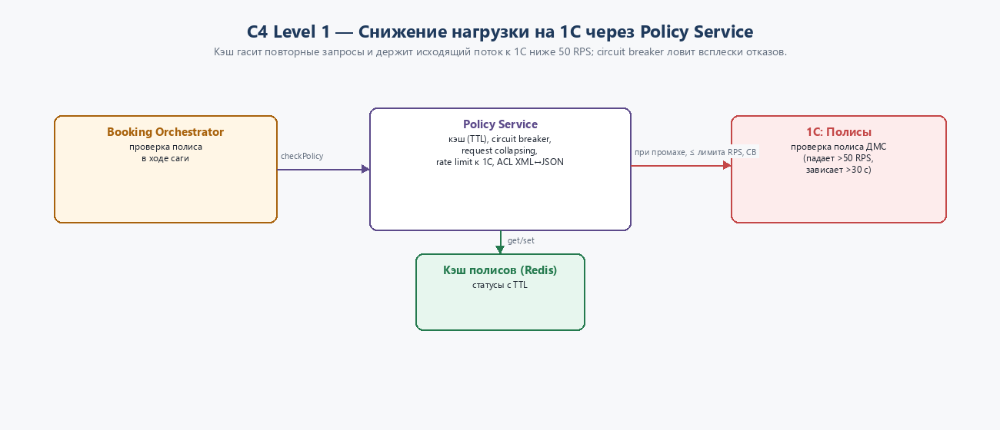

# Задание 4.1. Реализация отказоустойчивости интеграции между ИТ-системами

**Цель:** определить конкретные параметры и стратегии паттернов отказоустойчивости для вызовов к 1С и платёжному шлюзу.

## Контекст (из материалов)

1С («Полисы») не держит нагрузку >50 RPS и зависает >30 с (INT-003, SD-001), возвращает null (SD-008), контракт меняется без уведомления (Алексей). Платёжный шлюз при тайм-аутах списывает деньги без фиксации статуса (INT-001, SD-009), на тесте виснет ~10 с (SD-004).

> Допущение: точные SLA/тайм-ауты обеих систем в материалах не заданы. Значения ниже выведены из наблюдаемого поведения и предложены к согласованию с владельцами систем и после нагрузочного теста.

## Параметры отказоустойчивости

| Параметр | 1С («Полисы») — проверка полиса | Платёжный шлюз — оплата |
| --- | --- | --- |
| Характер операции | Чтение (идемпотентна по природе) | Запись денег (НЕ идемпотентна без ключа) |
| Тайм-аут | **2 с** (агрессивно: 1С умеет зависать на 30 с, нельзя держать поток) | **10 с** (платёж требует больше времени; наблюдаемое зависание ~10 с из SD-004) |
| Повторные попытки | **2 ретрая**, экспоненциальный backoff 200 мс → 400 мс + jitter; только на тайм-аут/503/5xx, НЕ на бизнес-null | **0 автоматических ретраев на charge**; повтор допустим ТОЛЬКО с тем же `Idempotency-Key` (1 раз), иначе риск двойного списания |
| Действие при fallback | Отдать кэшированный статус полиса; если кэша нет — разрешить запись в режиме «проверка полиса отложена» и доверифицировать асинхронно (деградация, не блокировка) | Перевести платёж в статус `PENDING`, не повторять вслепую; сверить итог через запрос статуса/webhook; при неуспехе — компенсация саги (void/refund). Никогда не списывать повторно |
| Дополнительно | Circuit breaker + кэш + ограничение исходящего RPS к 1С (bulkhead) | Idempotency-Key на каждый charge, Transactional Outbox для фиксации статуса |

## Для какой системы circuit breaker критичнее

**Circuit breaker приоритетно нужен для 1С.** Обоснование:

- 1С — это повторяющийся источник каскадных отказов: при >50 RPS она отвечает 503, а при зависании держит соединение/поток до 30+ секунд (INT-003, SD-001). Без CB потоки оркестратора и Policy Service копятся на «висящих» вызовах, пул исчерпывается, и отказывает уже весь поток записи, а не только проверка полиса. Это классическая каскадная деградация, и CB — главный инструмент против неё.
- Платёжный шлюз вызывается реже (один раз на запись, не на каждый запрос), а его ключевой риск — не каскад, а двойное списание. Он закрывается идемпотентностью, тайм-аутом и сверкой статуса, а не быстрым размыканием. Агрессивный CB на платеже даже вреден: разомкнуть посреди оплаты хуже, чем дождаться и свериться.

### Как работает circuit breaker (для 1С)

Три состояния:
- **Closed (замкнут):** запросы идут к 1С, считается доля ошибок/тайм-аутов в окне. Пока ниже порога — работаем как обычно.
- **Open (разомкнут):** при превышении порога (например, ≥50% ошибок на окне из N запросов) CB размыкается и на время (cool-down, например 30 с) мгновенно отклоняет вызовы к 1С, сразу уходя в fallback (кэш полиса). Это снимает нагрузку с падающей 1С и освобождает потоки вызывающих — даёт 1С восстановиться.
- **Half-open (полуоткрыт):** по истечении cool-down CB пропускает несколько пробных запросов. Успех → возврат в Closed; снова ошибки → обратно в Open.

Пороги (окно, % ошибок, cool-down) — стартовые и калибруются по нагрузочному тесту.

## Архитектурное решение для снижения нагрузки на 1С

**Policy Service — кэширующий фасад (ACL) перед 1С с ограничением исходящего RPS.** Результаты проверки полиса кэшируются с TTL (полис меняется редко), а обновление идёт асинхронно в фоне. Это убирает повторные одинаковые запросы к 1С, удерживает исходящий поток ниже порога 50 RPS (bulkhead / rate limiting на исходящих вызовах) и одновременно изолирует меняющийся XML/SOAP-контракт 1С за стабильным JSON (anti-corruption layer). Request collapsing схлопывает параллельные запросы по одному полису в один вызов к 1С.

Диаграмма C4 Level 1: [`offload-1c.puml`](offload-1c.puml), рендер [`offload-1c.png`](offload-1c.png).

