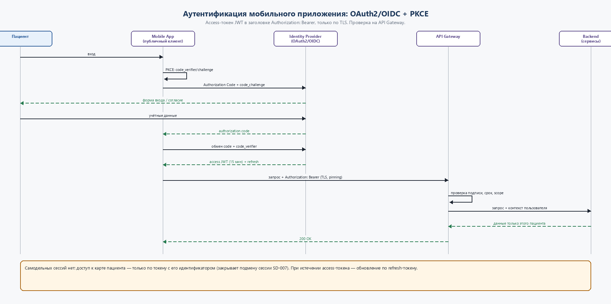

# Задание 4.3. Проектирование базовых мер безопасности

**Цель:** спроектировать фундаментальные меры безопасности для взаимодействия мобильного приложения с ИТ-системами.

## Контекст (из материалов)

Уже обнаружены: SQL-инъекция в поиске пациента (INT-006) и возможная подмена сессии — врач видит чужого пациента (SD-007). Приложение обрабатывает ПДн и медицинские данные, поэтому меры безопасности закладываются с первого дня.

## 1. Схема аутентификации пользователей

**Протокол: OAuth2 / OpenID Connect, grant type Authorization Code + PKCE** (рекомендованный поток для мобильных/публичных клиентов — у приложения нет секрета, который можно спрятать).

- **Способ передачи токена:** access-токен в формате **JWT** передаётся в заголовке `Authorization: Bearer <token>` **только по TLS**. Токен короткоживущий (например, 15 минут); отдельный **refresh-токен** (долгоживущий, хранится в защищённом хранилище устройства — Keychain/Keystore) обновляет access-токен без повторного ввода пароля.
- **Проверка:** токен валидируется на **API Gateway** (подпись, срок, издатель, аудитория, scope). Бэкенд-сервисы доверяют проверенному контексту пользователя из Gateway. Это устраняет самодельные сессии и их подмену (SD-007): доступ к данным пациента возможен только по валидному токену с идентификатором именно этого пациента.
- **Авторизация:** в JWT — `sub` (id пользователя) и роли/scope (пациент/врач). Сервисы проверяют, что запрошенный ресурс принадлежит владельцу токена (например, пациент видит только свои записи и анализы).

Схема: [`auth-flow.puml`](auth-flow.puml), рендер [`auth-flow.png`](auth-flow.png).

Поток: Mobile App → (Authorization Code + PKCE) → Identity Provider → access JWT + refresh → запросы с `Bearer` через API Gateway → проверка токена → доступ к сервисам.

## 2. Политики rate limiting

> Допущение: конкретные пороги — стартовые значения под целевую нагрузку (MVP 500, финал 50 000 пользователей в пик), калибруются по нагрузочному тесту. Лимитирование выполняет API Gateway (INT-010).

| Тип запроса | Лимит | Действие при превышении |
| --- | --- | --- |
| Публичный «Поиск врачей» (без авторизации) | 30 запросов/мин на IP + глобальный потолок на endpoint | Ответ `429 Too Many Requests` с заголовком `Retry-After`; при устойчивом превышении — временная блокировка IP (защита от скрейпинга/DDoS) |
| Авторизованный «Создание записи к врачу» (POST) | 5 запросов/мин на пользователя (+ обязательный `Idempotency-Key`) | Ответ `429 Too Many Requests`, запрос отклоняется; повтор с тем же `Idempotency-Key` не создаёт дубль записи |

Разные политики для публичного и авторизованного запросов: публичный уязвим к анонимному абьюзу и лимитируется по IP жёстче; авторизованный привязан к пользователю и защищается в связке с идемпотентностью (прямо закрывает дубли записей из INT-005/SD-003).

## 3. Меры защиты каналов передачи данных

- **TLS 1.2+/1.3 на всех каналах** (клиент↔Gateway и межсервисно); запрет устаревших протоколов и слабых шифров; HSTS.
- **mTLS для вызовов к чувствительным и legacy-системам** (1С, платёжный шлюз, межсервисное взаимодействие) — взаимная аутентификация сторон, а не только шифрование.
- **Certificate pinning** в мобильном приложении — защита от MITM и подставных сертификатов.
- **Единственная точка входа — API Gateway**: закрытый сетевой периметр, бэкенд-системы не доступны напрямую из интернета.
- **WAF перед Gateway** и **параметризованные запросы/ORM вместо конкатенации SQL** — закрывает SQL-инъекцию (INT-006); валидация и экранирование входных данных.
- **Никаких чувствительных данных в URL/query и логах** (ПДн/мед — только в теле по TLS); маскирование ПДн в логах и трассировке.
- **Шифрование данных at-rest** для ПДн/медданных (БД, бэкапы) и хранение секретов в vault.
- **Короткоживущие токены + отзыв**: ротация ключей подписи JWT, возможность отзыва refresh-токенов при компрометации устройства.
